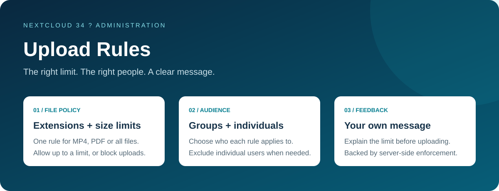

# قوانین آپلود — نسخه ۳.۰.۰


افزونه مستقل Nextcloud 34 برای مدیریت قوانین حجم و پسوند، با پیام اختصاصی و انتخاب گروه‌ها، کاربران و افراد مستثنا.

## استفاده از پنل

از **Administration settings → قوانین آپلود** یا `/index.php/settings/admin/upload_size_notice` وارد شوید و **افزودن قانون جدید** را بزنید.

برای هر قانون نام، پسوندها، سقف حجم یا ممنوعیت آپلود، پیام دلخواه و افراد مشمول تعیین کنید. پسوندها با ویرگول جدا می‌شوند؛ `*` یعنی همه فایل‌ها. جست‌وجوی گروه‌ها و کاربران از فهرست واقعی Nextcloud انجام می‌شود و صفحه‌بندی دارد. افراد مستثنا را جداگانه انتخاب کنید و **ذخیره قانون** را بزنید. ویرایش، حذف، فعال/غیرفعال‌کردن و تغییر اولویت در کارت هر قانون در دسترس است.

- حالت «همه» کاربران و مهمان‌ها را شامل می‌شود.
- در حالت انتخابی، عضویت در یکی از گروه‌ها **یا** انتخاب مستقیم کاربر کافی است.
- استثنای فردی از عضویت در گروه و انتخاب مستقیم اولویت بالاتری دارد؛ فقط همان قانون را کنار می‌گذارد.
- قوانین از بالا به پایین بررسی می‌شوند. **اولین قانون فعال منطبق با فایل و آپلودکننده اجرا می‌شود.** قانون جدید ابتدا قرار می‌گیرد. با دکمه‌های اولویت، ترتیب را تغییر دهید.
- فرد مستثنا ممکن است مشمول قانون بعدی باشد. اگر هیچ قانونی منطبق نباشد، این افزونه محدودیتی اعمال نمی‌کند.
- پیام می‌تواند از `{filename}`، `{limit}` و `{extension}` استفاده کند.
- واحد مگابایت برابر ۱۰۲۴×۱۰۲۴ بایت است؛ اندازه دقیقا برابر سقف پذیرفته می‌شود.
- پسوند به بزرگی حروف حساس نیست و بر اساس نام فایل بررسی می‌شود، نه محتوای آن.

مثال: قانون اول `mp4, mkv` با سقف ۵۰۰ مگابایت برای گروه آموزش و یک کاربر مشخص، با یک فرد مستثنا؛ قانون بعدی `*` با سقف ۳۰۰ مگابایت برای همه. افراد مشمول قانون اول می‌توانند ویدئو تا ۵۰۰ مگابایت بفرستند. فرد مستثنا و سایر افراد مشمول قانون عمومی ۳۰۰ مگابایت خواهند بود.

[English README](README.md) · [دانلود نسخه ۳.۰.۰](https://github.com/rezazare1234/nextcloud-upload-rules/releases/tag/v3.0.0)

تصویر بالا نمونهٔ نمایشی تنظیمات است.

## نصب و ارتقا

پیش‌نیاز: Nextcloud 34، نسخهٔ PHP سازگار با سرور و افزونهٔ `mbstring`. فایل نصب ZIP یا tar.gz را از صفحهٔ انتشار بگیرید و پوشهٔ داخل آن را استخراج کنید.

این بسته بدون امضای App Store منتشر می شود. نصب اولیه با قراردادن پوشه `upload_size_notice` در مسیر apps یا custom_apps ثبت‌شده در Nextcloud انجام می‌شود. سپس:

```bash
chown -R www-data:www-data /var/www/nextcloud/apps/upload_size_notice
sudo -u www-data php /var/www/nextcloud/occ app:enable upload_size_notice
```

مسیر نصب و کاربر وب‌سرور را مطابق سرور خود تنظیم کنید. تنظیمات بعدی کاملا از پنل انجام می‌شود. فایل‌های هسته Nextcloud تغییر نمی‌کنند.

پیش از جایگزینی نسخه قبلی، از پوشه افزونه و تنظیم `policy` در دیتابیس پشتیبان بگیرید. افزونه را غیرفعال، فایل‌ها را جایگزین و دوباره فعال کنید. غیرفعال‌کردن افزونه کنترل سروری آن را نیز متوقف می‌کند.

تنظیمات نسخه ۲ خودکار خوانده و به قوانین نسخه ۳ تبدیل می‌شوند: قوانین اختصاصی با حفظ اولویت قبلی، سپس قانون عمومی. با اولین ذخیره، قالب جدید در دیتابیس ذخیره می‌شود. **بازگشت به نسخه ۲ به بازگرداندن نسخه پشتیبان تنظیمات قدیمی نیز نیاز دارد.**

در ارتقای عادی Nextcloud، با حفظ دیتابیس و پوشه افزونه تنظیمات باقی می‌ماند. سازگاری فعلا فقط برای Nextcloud 34 اعلام شده است؛ پیش از ارتقای نسخه اصلی، سازگاری و مسیرهای آپلود باید آزمایش شود. این بسته هیچ Flow موجودی را خودکار حذف نمی‌کند؛ قوانین قدیمی تکراری باید آگاهانه بازبینی شوند.

## اجرا و دسترسی

پیش‌بررسی مرورگر در انتخاب فایل و کشیدن فایل/پوشه، سیاست جاری همان آپلودکننده را از سرور می‌خواند. کنترل مستقل DAV روی PUT و نهایی‌شدن آپلود تکه‌ای نیز اجرا می‌شود. در نهایی‌سازی، اندازه واقعی قطعات بررسی می‌شود. محدودیت بر اساس هویت آپلودکننده است، نه مالک پوشه مشترک. عضویت گروه در هر درخواست بررسی می‌شود.

فقط مدیر کامل Nextcloud می‌تواند قوانین را ذخیره کند یا فهرست افراد و گروه‌ها را جست‌وجو کند؛ کنترل استاندارد احراز هویت و CSRF فعال است. API عمومی سیاست فقط قوانین مؤثر را برمی‌گرداند و شناسه کاربران، گروه‌ها و افراد مستثنا را منتشر نمی‌کند. آپلود عمومی به‌عنوان مهمان ارزیابی می‌شود.

PUT با طول نامعلوم تا سقف مجاز+۱ بایت پیش از نوشتن مقصد در حافظه/فایل موقت بررسی می‌شود؛ اگر هیچ قانون منطبقی نباشد این بافر ساخته نمی‌شود. خطای حجم 413 و پسوند ممنوع 403 است. برنامه‌های موبایل و دسکتاپ ممکن است متن خطای خودشان را نشان دهند. فایل‌های موجود، انتقال‌های عادی و دانلود تغییر نمی‌کنند. محدودیت سهمیه، وب‌سرور یا Flow مستقل است.

## آزمون‌های قابل اجرا

```bash
php tests/policy.php
node tests/policy.cjs
```

سوابق آزمون در `docs/TESTING.md` آمده است. مجوز: AGPL-3.0-or-later.

[سابقهٔ آزمون‌ها](docs/TESTING.md) · [تاریخچهٔ تغییرات](CHANGELOG.md) · [متن مجوز](LICENSE)
