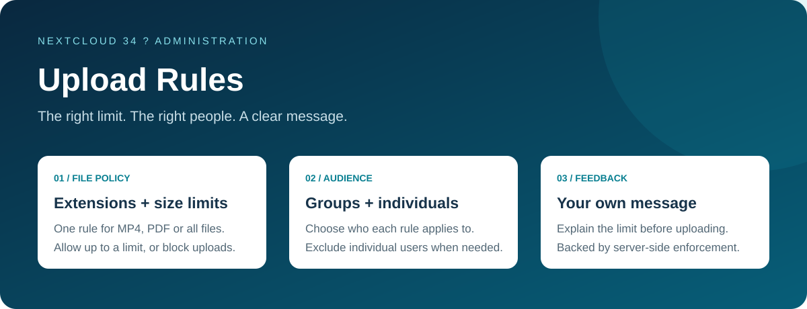
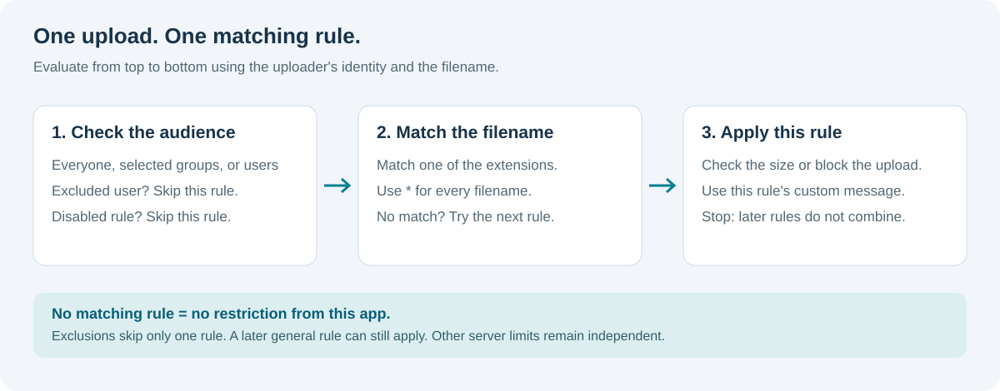

# Nextcloud Upload Rules


[راهنمای فارسی](README.fa.md) · [Release downloads](https://github.com/rezazare1234/nextcloud-upload-rules/releases/tag/v3.0.0)

Administrator-managed upload rules for **Nextcloud 34**, with Persian custom error messages, browser preflight checks and independent WebDAV enforcement.

The illustrations show sample settings and a rule flow diagram.

## Features

- Create, edit, enable, disable, delete and reorder rules in Administration settings.
- Match one or multiple filename extensions, or `*` for all files.
- Set a maximum file size or block uploads matching a rule.
- Configure a custom message per rule with `{filename}`, `{limit}` and `{extension}` placeholders.
- Apply a rule to everyone, selected groups, selected users, or both groups and users.
- Exclude individual users from a rule, including users explicitly selected or belonging to a selected group.
- Search actual Nextcloud users and groups from the administrator-only editor.
- Enforce limits on direct WebDAV uploads and final chunk assembly, independently of browser checks.

## Rule semantics




Rules are evaluated from top to bottom. **The first enabled rule matching both the uploader and filename wins.** Group and direct-user selections are combined with OR. An excluded user skips that rule, but a later rule can still apply. If no rule matches, this app imposes no limit.

The initial policy is a general 300 MiB rule. New rules are inserted above it. The UI labels sizes as MB; each unit is 1,048,576 bytes. Files exactly at the limit are allowed. Filename matching is case-insensitive; it does not inspect file contents.

The `Everyone` audience includes guest uploads. Selected-user/group rules do not apply to guests. Rules use the uploading user's identity, not the destination folder owner's identity.

For example, put a 500 MiB rule for `mp4, mkv` scoped to the Training group above a 300 MiB rule for everyone. A member excluded from the first rule falls back to the 300 MiB limit.

## Requirements and scope

- Nextcloud **34**; other major versions are not declared compatible.
- PHP **8.2+**, with the extensions required by Nextcloud, including `mbstring`.
- No Composer or npm dependencies and no frontend compilation step.
- The administrator interface and initial messages are Persian.

Public-share upload was not tested end-to-end in the original environment because guest uploads were disabled there. Desktop/mobile clients may display their own error wording. Existing files, ordinary moves, quota limits and independent web-server/Flow restrictions remain outside this app's configuration. See [validation history](docs/TESTING.md).

## Install

Download the installable `upload_size_notice-<version>.tar.gz` or `.zip` from [the v3.0.0 release](https://github.com/rezazare1234/nextcloud-upload-rules/releases/tag/v3.0.0), or build it locally with `python tools/build.py`.

Extract the single `upload_size_notice` directory into a configured writable Nextcloud apps directory. Example for a conventional Linux installation:

```bash
sudo tar -xzf upload_size_notice-3.0.0.tar.gz -C /var/www/nextcloud/apps/
sudo chown -R www-data:www-data /var/www/nextcloud/apps/upload_size_notice
sudo -u www-data php /var/www/nextcloud/occ app:enable upload_size_notice
```

Adapt the paths and web-server account to your installation. The directory must be named **upload_size_notice**, not the GitHub repository name. GitHub's automatic source archives contain repository tooling; use the installable release assets for deployment.

Open **Administration settings → قوانین آپلود**, or `/index.php/settings/admin/upload_size_notice`, then choose **افزودن قانون جدید** (Add new rule).

## Upgrade and rollback

Back up the app directory and its `policy` app configuration before upgrading. Disable the app, replace its files and enable it again. Disabling it also disables its upload enforcement. This app does not modify Nextcloud core files or automatically remove existing Flow rules.

Version 2 policies are converted to ordered version 3 rules while preserving their previous precedence. Saving persists the new schema. Rolling back to version 2 requires restoring the old configuration as well as the old code. Preserve the app directory and database during server upgrades; test compatibility before upgrading Nextcloud to a new major version.

## Development

With PHP 8.2+ (`mbstring`), Node.js 18+ and Python 3.10+ installed:

```bash
python tools/check.py
python tools/build.py
```

`check.py` runs PHP syntax checks, the PHP and JavaScript policy tests, JavaScript syntax checks, and metadata checks. `build.py` creates ZIP, tar.gz and SHA256SUMS under `dist/`, using an explicit list of app files. Deployment helpers, local configuration, screenshots and repository history are not packaged.

[Contributing](CONTRIBUTING.md) · [Changelog](CHANGELOG.md) · [Security](SECURITY.md)

## License

AGPL-3.0-or-later. See [LICENSE](LICENSE). This repository is an unsigned community app, not an official Nextcloud product or an App Store-signed release.
